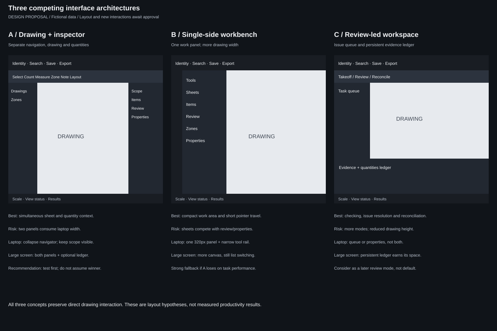
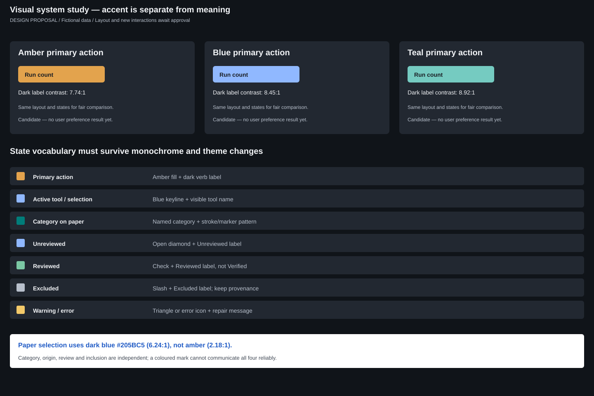
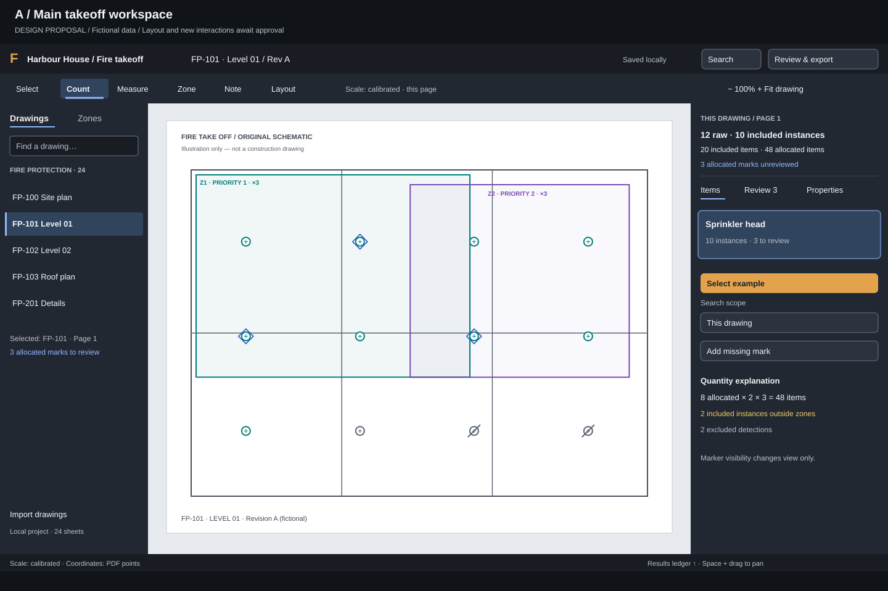
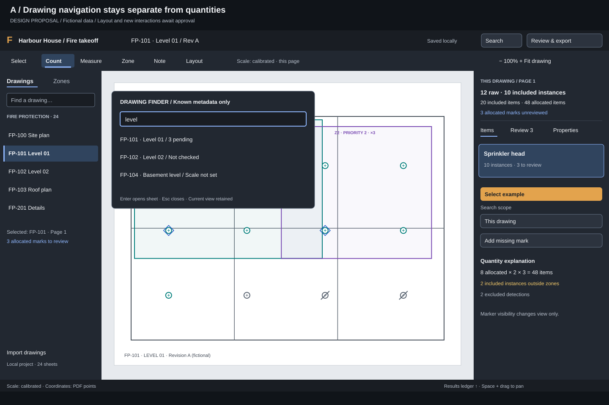
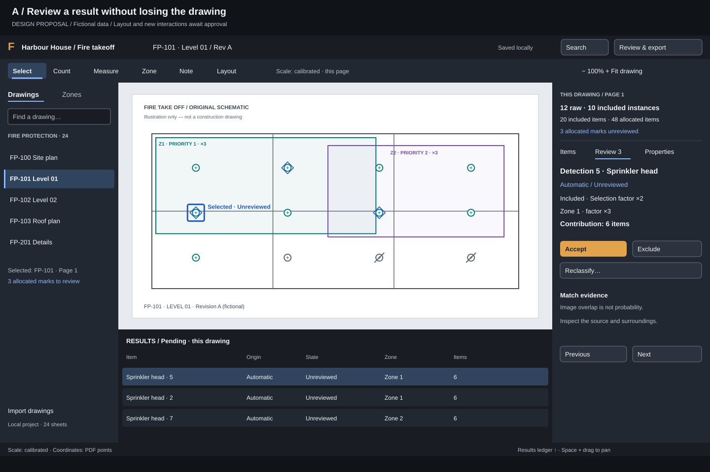
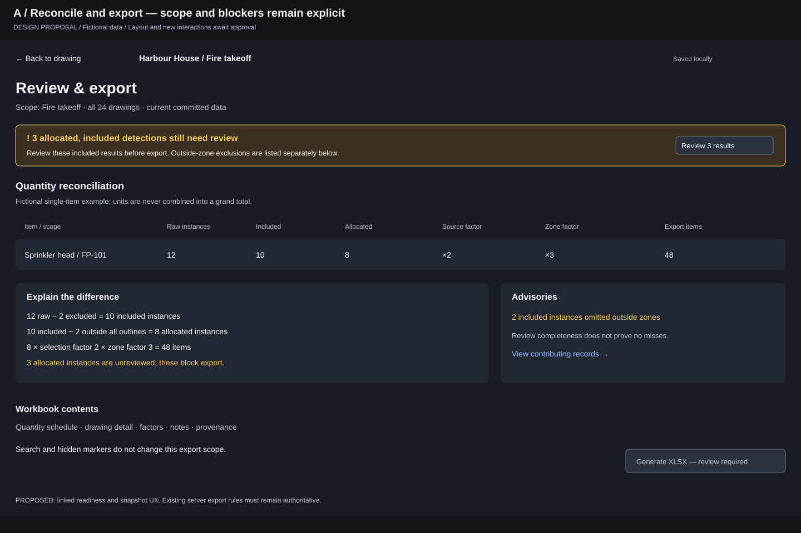

# Fire Take Off — UI/UX research and design proposal

**29 October 2026 · Proposal for discussion · No UI implementation authorised by this document**

## Decision in brief

Recommend **Concept A: Drawing + inspector**: stable drawing navigation on the left, a labelled horizontal tool strip, a large white PDF workspace, and a right inspector that keeps scoped quantities and review status visible. A collapsible bottom ledger supports reconciliation. Use graphite surfaces, restrained amber primary actions, separate blue selection/focus treatments, and explicit review/inclusion labels.

This is an expert design hypothesis, not a usability-tested winner. Concept B may outperform it on laptops. Do not begin implementation until the owner approves the layout, visual system and interaction direction. The user's latest instruction supersedes the earlier requirement to reproduce Countfire's interface: functional competition remains the goal; the interface should be distinctly ours. Catalogue work remains deferred.

The most important change is **making quantity meaning and uncertainty visible**, not changing colours. A reviewed detection, an included mark, an allocated quantity and an export-ready schedule are different things. The design must preserve those distinctions.

### Read alongside

- [Three concepts](wireframes/concepts.svg)
- [Main workspace](wireframes/workspace.svg), [drawing navigation](wireframes/navigation.svg), [review](wireframes/review.svg), [reconciliation/export](wireframes/export.svg), [laptop layout](wireframes/laptop.svg)
- [Palette and state study](wireframes/palette.svg)
- [Complete 77-entry functionality audit](FEATURE_AUDIT.md)
- [Source register and access limitations](SOURCE_REGISTER.md)
- [Audit evidence](../evidence/design-research-2026-10-29.json)

Wireframes are original static illustrations with fictional data. They describe a proposed destination, including clearly identified future capabilities. They are not screenshots of implemented software, interactive prototypes or evidence of numerical correctness.

## 1. Research method and findings

### Evidence boundaries

**Documented** means read in an identified official source. **Observed** means visible in the authorised Countfire demo or our local running app. **Code/test evidence** means inspected source and an actual passing check. **Recommendation** means our proposed design, still unvalidated with estimators. These categories must not be conflated.

Reviewed repository guidance, architecture, feature inventory, workflow specifications, acceptance records, module structure, styling, critical calculation/persistence/export paths, and test coverage. Reran the complete existing automated suite: **125 passed, 0 failed, 20,543.946924 ms**, Node 24.22.x on the local macOS environment. Tests use owned fixtures and isolated stores. This is not a fresh manual execution of every feature or an independent representative construction-drawing benchmark.

Inspected the live local drawing interface and authorised Countfire demo interface without saving reference changes. Reviewed official Figma and Bluebeam interface illustrations and Autodesk documentation. No hands-on Figma, Bluebeam or Autodesk session was available. Apple pages often returned a JavaScript shell to the web reader; browser-rendered HIG pages supplied the relevant content. Failed/stale URLs and the initially ineffective browser resize are disclosed in the source register.

### Apple: learn the structure, not the surface decoration

Apple's [macOS guidance](https://developer.apple.com/design/human-interface-guidelines/designing-for-macos) addresses sustained work, precision input, multiple windows and comfortable information density. Its [sidebars](https://developer.apple.com/design/human-interface-guidelines/sidebars) support collection navigation; [toolbars](https://developer.apple.com/design/human-interface-guidelines/toolbars) organise frequent commands; [windows](https://developer.apple.com/design/human-interface-guidelines/windows) distinguish main content from supplemental inspection. These conventions help people predict where to find something and preserve attention on their document.

**Our inference:** sheets are a collection, so a navigator is appropriate; selected geometry has properties, so an inspector is appropriate. Neither source proves that all takeoff applications need two side panels. Apple platform recommendations are not direct web requirements. In particular, guidance against vertical toolbars in visionOS is not evidence against a desktop tool rail.

[Typography](https://developer.apple.com/design/human-interface-guidelines/typography) emphasises readable weights, hierarchy and adaptation. [Icons](https://developer.apple.com/design/human-interface-guidelines/icons) emphasises simple recognisable shapes and consistent optical weight. **Recommendation:** use a system font, readable quantity tables and labelled specialist tools. Do not import a font file or imitate native widgets merely to look Apple-like.

[Dark Mode](https://developer.apple.com/design/human-interface-guidelines/dark-mode) generally follows system appearance and supports both modes; it does not endorse dark-only professional software. It even suggests softening white images in some dark contexts. **Our deliberate departure:** preserve PDF source colours by default because faint technical linework matters. Use a neutral matte around the page, test glare in real lighting, and plan a light/system appearance. A per-app appearance override would be a conscious web-workspace choice, not an Apple requirement. Avoid translucent controls over drawings: their changing background makes precise inspection harder.

### NNGroup: reduce competition, retain capability

[Complex application design](https://www.nngroup.com/articles/complex-application-design/) supports contextual help, expert accelerators, nonlinear work and recovery from interruptions. [Progressive disclosure](https://www.nngroup.com/articles/progressive-disclosure/) separates frequent choices from specialised options; it is different from forcing everyone through a wizard.

**Recommendation:** keep Select, Count, Measure, Zone, Notes and review status discoverable. Disclose sample-element editing, factors and advanced alignment only in their context. Never hide scale errors, export blockers or the scope of a quantity behind an overflow menu. Estimators must be able to return from reconciliation to a drawing and resume without losing their place.

### Countfire: preserve efficient workflows, reconsider information distribution

The [takeoff product page](https://www.countfire.com/product/takeoff-software) documents selecting symbols, counting across drawings, measurement and outputs. The [April 2025 experience article](https://www.countfire.com/blog/new-takeoff-experience) describes persistent drawing access, Space panning, grouped items, clearer save feedback and contextual tool behaviour. It is historical documentation, not a guarantee about today's beta.

**Observed today:** dark shell, breadcrumb/project/takeoff identity, drawing chooser, left vertical Count/Measure/Zone/Note/Layout/Page rail, adjacent context panel, explicit Save changes, white drawing, floating background/scale/navigation controls. The empty Count panel explains the first selection. Earlier repository evidence records selection editing/movement, groups and copy-item controls; those experiments were not repeated in this research phase.

**What works:** direct symbol selection, spatial context, persistent tool families and a visible path back to drawings. **Our heuristic concerns, not measured competitor failures:** floating controls can cover useful linework; scope/review information can compete with creation controls; unusual shortcut chords require learning. Our differentiation is an explicit quantity/review model, separated navigation and inspection, and a reconciliation surface—not just changing Countfire's orange to amber. No competitor source code or interface assets are part of the proposal.

### Other professional applications

| Source | Documented/illustrated pattern | What we should take; what we should resist |
| --- | --- | --- |
| [Bluebeam Revu interface](https://support.bluebeam.com/user-manual/welcome/revu-interface.html) and [selection](https://support.bluebeam.com/revu/how-to/select-markups.html) | Customisable panels/toolbars, contextual properties, bottom Markups List; list/canvas selection and overlap selection assistance | A linked ledger and explicit overlap chooser. Avoid exposing a large ribbon of specialist commands all the time. |
| [Bluebeam measurement practice](https://support.bluebeam.com/revu/how-to/follow-best-practices-for-measurement-markups.html) | Scale, units and measurement properties are part of the measurement workflow | Make scale a prerequisite with a clear repair path. Multiple scale viewports are a future capability, not something our one-scale-per-page model can pretend to support. |
| [Autodesk viewer tools](https://help.autodesk.com/cloudhelp/ENU/Takeoff-Takeoff/files/Viewer_Tools.html), [inventory](https://help.autodesk.com/cloudhelp/ENU/Takeoff-Takeoff/files/Inventory.html) | Spatial tools plus cumulative inventory grouped by type/document/location, contextual details, export | Link each ledger row back to geometry. Retain context when changing classification. A bottom toolbar is a viable convention, not evidence that top is wrong. |
| [Autodesk scale](https://help.autodesk.com/cloudhelp/ENU/Takeoff-Takeoff/files/Set_Scale.html) | Two-point calibration with units; explicit sheet scope and constrained multi-sheet application | Make the calibrated page explicit. Do not infer scale from a filename or copy it silently across revisions. |
| [Figma design files](https://help.figma.com/hc/en-us/articles/15297425105303-Explore-design-files), [navigation](https://help.figma.com/hc/en-us/articles/360039831974-Explore-the-navigation-bar-and-left-sidebar) | Navigation/left structure, central canvas, right selection properties, separate creation toolbar; current official illustration uses a floating bottom toolbar | Stable spatial roles and context-sensitive properties. Do not copy floating tools onto drawing linework or automatically pop panels open after the user has deliberately collapsed them. |

These sources demonstrate useful conventions, not comparative productivity evidence. This research did not measure competitor task times or establish that any product's layout is optimal for fire estimating.

## 2. Existing application audit

### What works within tested bounds

There is real software to preserve: local project/takeoff/discipline persistence; bounded PDF intake; PDF rendering and coordinate transforms; pointer-centred zoom and Space/middle-button pan; notes; symbol examples and bounded matching; cross-drawing counts; manual additions/exclusions/reclassification; flat groups; editable source selections and multipliers; point/length/area measurements; calibration; zones with ordered allocation; coverage circles; temporary overlays; saved floorplans; bounded raster revision comparison; explicit revision recount; quantity schedules and XLSX output.

The canonical inventory has **77 entries: 35 TESTED partial scopes, 42 NOT STARTED, none VERIFIED**. This is not a completion percentage: entries differ greatly in size, and F059 is an open discovery bucket. [The appendix](FEATURE_AUDIT.md) carries every ID, acceptance requirement and limitation. Generic count/measure tools do not establish validated sprinkler or hydrant workflows.

### Architecture and design constraints

| Area | Current structure | Design implication |
| --- | --- | --- |
| Shell | Native browser ES modules; global DOM IDs in `index.html`; shared state/context and refresh orchestration in `app.mjs` | Preserve event contracts initially. A framework migration is neither required nor approved. |
| Feature UI | Factories for count groups, selection editing/movement/deletion, measurement editing, zones, overlays, comparison, floorplans and drawing picker | Good seams for incremental panel changes; shared activation/cancellation still needs explicit coordination. |
| Styling | `style.css`, `projects.css`, then `drawing-workspace.css`; global selectors, fixed offsets and overrides | Introduce semantic tokens and component boundaries only after approval. Avoid another layer of overriding CSS. |
| Calculations | Separate geometry, quantity-factor and zone-allocation modules; workbook generation on the server | Display their results. Never duplicate allocation mathematics in a visual component. |
| Persistence | Loopback Node service, SQLite schema 16, immutable hashed PDF sources, version checks and audit records | “Saved locally” is truthful; “Synced”, collaboration, offline queue and global undo are not available. |
| Rendering | PDF.js; DOM/SVG overlays and lists; broad refresh/repaint paths | No demonstrated performance guarantee for thousands of visible symbols. Virtualisation/render scheduling require measured engineering work. |

Current provisional bounds include 25 MiB/200 pages per imported PDF, isolated bounded parsing, a 16-million-pixel backing canvas, and bounded recognition work (including 20 pages/5,000 matches per run). These are limits, not acceptable professional capacity targets. The matcher principally expects matching size/orientation; it is not a validated semantic fire-symbol detector. “Image overlap” is a matching score, not calibrated probability.

### Ranked UX findings

| Severity | Evidence | Consequence and proposed response |
| --- | --- | --- |
| Critical to interpretation | Heading totals aggregate included marks across a discipline; the viewer is one drawing/page; zoned export is a different projection | Label scope on every total. Separate raw instances, included weighted quantity and allocated export quantity. Never show an unqualified green total. |
| High | At 1792×907, Count panel is 350×815 but content height is 1428; review list starts at y≈1240. At emulated 1280×800, panel remains 350 wide and only 708 high | Put quantities/review ahead of creation details; use explicit inspector tabs and a ledger, not one growing panel. |
| High | Zone order gives overlaps to earlier headings; pages with outlines omit outside-zone geometry from allocation | Show priority and outside-zone exclusions explicitly. Preview changes before committing once that capability exists. |
| High | Immediate API saves coexist with Save/Cancel geometry drafts; no common undo manager, save-state model or draft guard | Design a truthful transaction model before suggesting universal autosave or Undo. |
| High | Unreviewed/reviewed included marks both use check-like markers with style differences; manual additions are immediately reviewed | Separate origin, review state and inclusion. “Reviewed” must not imply independently verified accuracy. |
| Medium | Global header repeats drawing title and selector; project/discipline/revision context and export readiness are not integrated | Use a compact identity breadcrumb, explicit document title/scope, and a persistent route to Review & export. Revision metadata must not be invented. |
| Medium | Small controls: a 22×22 selection-delete target and short group selectors observed; custom focus CSS covers buttons/links/inputs but not every interactive primitive | Audit hit areas including labels/spacing exceptions; ensure all controls, handles, lists and splitters have focus/keyboard behaviour. Small bounding boxes alone are not an automatic WCAG failure. |
| Medium | Unicode tool glyphs, 12px action labels, layered overrides and floating controls at fixed offsets | Use a coherent icon family, stronger text hierarchy and layout constraints. Avoid shrinking controls to make everything fit. |
| Medium | Temporary notices, some modal metadata/group edits, unvirtualised results and no persistent viewport | Persistent actionable errors; inline properties; preserve view context and selection when switching sheets. |

### Quantity semantics that must survive redesign

The implementation in `zone-allocation.mjs` unions outlines within a heading and applies headings in priority order. Overlaps go to the first eligible heading. Points on boundaries use the first matching heading; lines/areas allocate by geometry fractions. With no zone outlines on a page, the whole page contributes. Once outlines exist, geometry outside all zones contributes no allocated quantity. A source factor and zone factor can both affect the result.

For illustration only: 10 included raw marks with selection factor 2 represent 20 items. If 8 marks lie in a zone with factor 3 and 2 lie outside all outlines, the schedule contains 48 items, not 20 or 60. The UI should explain “8 allocated instances × 2 × 3; 2 outside zones”, not call 48 a detection count. Mixed factors require row-level reconciliation, not one invented global multiplier. Measurements use geometric fractions; never add metres, square metres and items into one grand total.

The current workbook blocks **included, allocated, unreviewed** marks in its selected takeoff. An unchecked mark outside all zones does not trigger that gate. Allocated length/area rows without scale block export. Search/visibility filters do not redefine export scope. The proposed readiness panel must reflect these existing rules accurately; changing them requires a separately approved calculation/policy decision.

Review completeness also cannot prove there are no missed symbols. A source sheet with no detections needs a deliberate checking workflow; a zero result must never automatically become “complete”. Existing audit records support provenance but are not a user-facing, exhaustive, reversible history system.

### Documentation discrepancies found

F007 still says note export is missing, but `workbook.mjs` creates a Notes sheet. F056 remains NOT STARTED although several shortcuts exist; comprehensive keyboard operation remains incomplete. F032's old limitation mentions missing recount, now partly provided by F033. F036 covers an output-package lifecycle; it should not obscure the working single XLSX export. The appendix flags these without promoting feature states.

## 3. Three competing concepts

### A — Drawing + inspector (recommended for evaluation)

Top: compact project/takeoff/drawing identity and global search, local save status, Review & export. A docked horizontal strip contains Select, Count, Measure, Zone, Note and Layout, followed by contextual options. Left: searchable discipline → drawing → page navigator, with a Zones tab for ordered zone headings. Centre: PDF and spatial overlays. Right: persistent scope and quantities, with **Items / Review / Properties** tabs. Bottom: slim view/scale status; optional resizable results ledger.

Primary navigation is projects → takeoff → drawing, independent of tool choice. Secondary navigation is inspector tabs and contextual tool options. Selecting geometry opens its properties only when the inspector is available; it must not unexpectedly reopen a collapsed panel. The Items/Review badges and scope summary remain visible above the tab content. Zone selection uses the left zone list and right properties; counts remain reachable in one tab.

**Benefits:** sheets and quantities stay available together; review is a first-class destination; properties do not displace the drawing navigator. **Costs:** eye travel across the canvas; two panels consume width; tabs can hide detail. Pin the scope summary, keep counts one action away, and provide an explicit focus-drawing mode.

At 1440px, 240px navigation + 320px inspector leaves 880px drawing width before gutters; at 1920px it leaves 1360px. At 1280px, start the working state with a collapsed 48px navigator and 320px inspector: 912px remains. These are layout arithmetic, not measured usability improvements. Opening the navigator is a deliberate choice; don't silently hide it mid-task. Below 1200px use one side work panel with Drawings/Takeoff switching; preserve a visible sheet selector. At enlarged browser text, panels may stack; the page remains a two-dimensional surface.

**Difference from Countfire:** separated drawing/navigation and quantities, horizontal labelled tools, explicit result provenance and reconciliation drawer, fewer controls floating over the PDF.

### B — Single-side workbench

Top: identity/search/save/export and document/view controls. Left: narrow vertical mode rail plus one resizable work panel with Drawings / Items / Review / Zones views and inline selected-item properties. Centre/right: drawing takes the remaining area. Bottom: scale and expandable quantity ledger. Primary project navigation remains top; secondary navigation is entirely in the left work panel.

**Benefits:** strong laptop canvas width; short travel between lists and tools; simple window geometry and closest to the current app's architecture. **Costs:** changing sheets competes with reviewing quantities; properties can push results down again; only one list context is visible. It must use bounded subviews, not reproduce today's long stack.

At 1280px, a 48px rail + 320px panel leaves 912px. On a large monitor the canvas grows, but simultaneous drawing-list and item-list work still needs switching. Optional pop-outs would add complexity and are not part of the first version.

**Difference from Countfire:** an explicit searchable navigation/review model, scope header and linked ledger. Nevertheless it remains structurally closest to Countfire and is the least distinctive concept. Choose it if laptop tests show substantially fewer navigation errors than A.

### C — Review-led workspace

Top: project identity and non-linear **Takeoff / Review / Reconcile** workspace tabs, save/search/export. Left: task queue grouped by drawing, warning or classification. Centre: drawing focused on the current task. Right: optional compact properties. Bottom: a persistent quantity/evidence table during Review and Reconcile; creation tools appear in a horizontal strip in Takeoff. Every workspace preserves selection and viewport.

**Benefits:** excellent visibility of unresolved work and bulk reconciliation; suits handover and checking sessions. **Costs:** additional modes, more state to remember, reduced drawing height, and risk of implying a linear completion process despite uncertain detection coverage. On laptops the queue and inspector must be mutually exclusive; the ledger can overwhelm the page. Large screens can keep queue, drawing and ledger visible.

**Difference from Countfire:** task/issue-driven information architecture rather than a tool-first takeoff screen. Recommended as a later review mode inside A, not the initial default.

### Decision matrix — design judgement, not experimental data

Scores 1–5; weighted totals are a transparent argument, not scientific precision.

| Criterion | Weight | A | B | C |
| --- | ---: | ---: | ---: | ---: |
| Quantity clarity and drawing context | 30% | 5 | 4 | 5 |
| Frequent count/correction throughput | 25% | 4 | 4 | 3 |
| Learnability/discoverability | 15% | 4 | 4 | 3 |
| Laptop practicality | 15% | 3 | 5 | 2 |
| Accessible interaction potential | 10% | 4 | 4 | 4 |
| Preservation/ease of staged migration | 5% | 4 | 5 | 2 |
| Weighted score | 100% | **4.15** | **4.20** | **3.50** |

B narrowly wins the general weighted sum. I still recommend testing A first because the highest-risk problem is simultaneous quantity/drawing context, and the general scores understate that specific need. This is a judgement call, not a reason to manipulate weights until A wins. If A requires frequent panel switching or hides the sheet at laptop sizes, choose B. Usability evidence must override the recommendation.

## 4. Recommended placement rules

| Location | Contents and rationale | Exclusions/conditions |
| --- | --- | --- |
| Global header, 48px target | Project/takeoff breadcrumb; drawing title/selector; known revision label; search; saved locally/error; Review & export | Keep branding small. “Revision unknown” is preferable to inferred metadata. Global search is future work; current drawing filtering can be reused. |
| Tool strip, 44–48px | Six labelled tool families; mode-specific subtool; scope/calibration beside Count/Measure | Dock outside paper. Fewer than eight primary choices; less frequent Layout operations in a labelled menu. Never hide Scale not set in overflow. |
| Left, 220–300px | Drawings and Zones tabs; search; current discipline; optional page expansion | Two common hierarchy levels, pages on demand. Avoid a project→takeoff→discipline→floor→drawing→page tree. Zones are allocation regions, not drawing folders. |
| Centre | White PDF, handles, selection outline, unobtrusive numeric labels; temporary calibration/draft feedback | No permanently floating save/export/help controls over drawing content. Existing PDF colours remain intact. |
| Right, 300–380px | Scope selector, raw/included/allocated summary, pending badge; Items / Review / Properties | Advanced example editing expands locally. Scope changes affect display only unless an action explicitly names its search/export scope. |
| Bottom, 28px + optional drawer | Scale, page position/coordinates with units, zoom/fit; resizable ledger on request | Errors requiring action appear in context and the readiness header too. Coordinates may be hidden; scale may not. |

Resizable splitters need pointer and keyboard operation, sensible minimums and reset-layout. Persist panel widths and per-sheet viewport as view preferences, separate from project quantities. Preserve the PDF-space centre when a panel resizes; do not refit the page unexpectedly. Do not automatically collapse an inspector because its selection temporarily disappears during a refresh.

**Why horizontal tools?** Six labelled families fit and expose specialist actions without a rail's learned glyph vocabulary. A rail saves height and scales to more tools; it is preferable if our labels fail at laptop widths. Keep an explicit comparison in prototype testing. Avoid both a full rail and a duplicate full toolbar.

## 5. Visual design system proposal

### Colour roles and measured candidate contrasts

Use semantic tokens with appearance variants, not colour names scattered through components. Hex values below are proposed dark-mode values. Ratios were calculated using WCAG sRGB relative luminance with opaque fills; they do not certify a rendered application.

| Role | Candidate | Pair/contrast |
| --- | --- | --- |
| Shell / panel / raised surface | `#191D23` / `#222831` / `#2C333E` | Layer hierarchy; not sufficient by itself to identify controls |
| Primary / secondary / muted text | `#F2F4F7` / `#B8C0CC` / `#9AA6B5` | On panel: **13.46 / 8.09 / 6.00:1** |
| Primary action, amber | `#E3A34D`, dark label `#191D23` | **7.74:1**; hover `#F0B45F` requires its own final check |
| Focus on dark surfaces | `#90B8FF` | On panel **7.41:1** |
| Selected geometry/focus on paper | `#205BC5` + white halo | On white **6.24:1** |
| Control boundary | `#657386` | On panel **3.07:1**; narrow margin, use a lighter border on raised surfaces |
| Decorative separator | `#3B4452` | Decorative only; never the sole input/selection boundary |
| Success / warning / error | `#7BC8A4` / `#F3C969` / `#F28B82` | On panel **7.51 / 9.44 / 6.21:1**, plus icon and text |
| Category strokes on paper | `#007D7A`, `#7A4BB3`, `#9B4B00` | On white **4.98 / 6.03 / 6.18:1**; add labels and line/marker patterns |
| Paper / surrounding matte | `#FFFFFF` / `#E7EAEE` | Source fidelity and page boundary, independent of shell theme |

Amber on white is only **2.18:1**. It must not be the sole thin selection outline or small text on the PDF. Darken paper annotations independently; do not apply the brand accent everywhere.

Compared candidates: amber action/dark label 7.74:1; blue `#90B8FF`/dark label 8.45:1; teal `#75CBC1`/dark label 8.92:1. All work as opaque filled buttons. Blue has a familiar selection association but is less distinctive; teal competes with common annotation/success colours. Amber is a reasonable brand/action choice, not objectively superior. Test all three with identical states and tasks, including monochrome and colour-vision simulations. Warning uses a triangle, explicit text and a separate container; if people still confuse it with amber actions, prefer blue actions rather than defending the brand preference.

### Independent state dimensions

- **Application action:** amber filled primary button; only the current task's primary action receives that weight.
- **Active tool:** blue keyline/underline and pressed state, with a visible name. Keyboard focus has an outer ring, separate from selection.
- **Category:** chosen annotation colour plus name/short code and legend. Category never implies approval.
- **Origin:** Automatic or Manual label in list/inspector; distinguish source selection and later corrections.
- **Review:** Unreviewed open-diamond marker and text; Reviewed check and text. “Verified” reserved for a separately defined validation process, not today's boolean.
- **Inclusion:** Included solid mark; Excluded slashed mark with reason in detail. Visibility is an eye control labelled “Hide markers — view only”.
- **Warnings/completion:** triangle + text, error icon + repair action, check + explicit completed operation. “Export generated” is not “All symbols found”.

Do not draw six badges on every symbol. Use a compact spatial marker for category/review, a strong selected outline, and complete state in the linked row/inspector. Overlapping marks require a chooser. Always offer a monochrome-readable legend and a non-spatial list.

### Other tokens

| Family | Proposal |
| --- | --- |
| Typography | `system-ui` stack; regular 400, medium 500, semibold 600; 14px body/controls, 13px dense rows, 12px secondary metadata, 16px section, 20px project title. Relative units and 200% text support. Tabular numerals, right-aligned values, explicit units. No ultra-light text or tiny essential labels. |
| Spacing | 4/8/12/16/24/32px scale. 8px within related controls, 16px between groups, 24px between sections. Density is task-driven; no marketing-page whitespace. |
| Size | 32–36px desktop controls/rows, at least 24×24px targets unless a documented exception applies; 44px comfortable touch variant. Enlarged invisible hit areas must not overlap adjacent actions. |
| Radius | 4px fields, 6px buttons, 8px panels/popovers, 10px dialogs. Avoid pervasive pills. |
| Borders/depth | 1px separators; strong boundaries where needed; one restrained popover shadow, no drawing-obscuring glass/gradients. |
| Icons | Consistent original or licensed SVG family, 16/20px, approximately 2px strokes with optical correction. Labels for domain tools; accessible names for icon-only controls. Asset selection/licence review remains future work. |
| Focus | 2px ring + 2px offset as design target; light ring on dark shell, dark blue on light surfaces, dual contrast when crossing imagery. Test adjacent colours and obscuration. |
| Motion | Immediate tool changes; optional 80–120ms fades; reduced-motion support. No animated zoom required for correctness, no decorative pulsing. |

A complete light/high-contrast token set must be designed and tested before claiming theme support. This report establishes the strategy and dark candidate palette, not a production-ready token package.

## 6. Main workflows and interaction contracts

Availability: **Existing** = tested partial underlying capability; **Presentation** = proposed UI over it; **New behaviour** = additional engineering required. None of the proposed screens exists today.

| Workflow | Proposed interaction | Availability and safeguards |
| --- | --- | --- |
| Create/open/load | Project list → named takeoff/discipline → Import drawings; per-file progress, accepted/rejected rows and retry | Existing local hierarchy/import. New batch-progress polish; show actual limits before upload, preserve successful files if another fails. No cloud claim. |
| Find/switch | Persistent sheet selector; navigator search by existing filename/title/discipline; page expansion; restore viewport | Existing chooser/filtering and page metadata. New persistent view context/global search. Don't imply OCR/title extraction exists. |
| Calibrate | Measure → Scale not set → two known points → distance/unit → check preview → Apply to this page | Existing calibration. Proposed scope/impact explanation; new before/after impact preview and draft guard. Confirm consequences when measurements exist; never silently propagate to other pages. |
| Automated count | Choose item/scope → Select example → preview crop → Run on named scope → progress/cancel → Review results | Existing bounded example/matcher/cancellation. Proposed clearer staged controls. Show supported size/orientation and failed pages; no fake probability or automatic completeness. |
| Review/correct | Review tab → pending row → canvas focus + sample context → Accept / Exclude / Reclassify / Add missing → next | Existing per-mark review, reclassification and manual marks. New durable cross-sheet queue, resumable position and reliable undo. Keep selection after an error. |
| Zones/overlap | Zones list in priority order; select outline; edit right properties; show overlapping region and winning heading; apply draft | Existing outlines/order/allocation. New overlap visualisation and proposed quantity delta. Outside-zone omission must remain visible. A change of order is a quantity-affecting edit. |
| Pipe/area/points | Choose type before drawing; show units/scale; click vertices; explicit Finish; edit vertices in inspector | Existing analytic point/length/area editing. New snapping, keyboard/non-drag geometry entry. Connected pipe systems/fittings/drops are not built. |
| Understand completeness | Scope summary distinguishes raw, included, reviewed, allocated and omitted; show unresolved-source-check status | Derived data partly exists. New completeness model needed; never infer “checked sheet” from zero pending detections. |
| Resolve discrepancy | Click warning/ledger difference → filter affected records → highlight geometry → edit → recalculate from server | Existing source IDs, audit/provenance and schedule. New linked reconciliation UI and richer issue classification. |
| Export Excel | Review & export → explicit takeoff scope → show actual blockers/advisories → inspect schedule → Generate XLSX | Existing server gate/workbook. New readiness/preview presentation, revision-bound snapshot and stale-output UX. Never let a search filter silently remove exported rows. |

### Review model

Review rows show drawing/page, item, origin, review state, inclusion, source factor, zone and effective quantity. “Image overlap” may appear as technical match evidence, with an explanation that it is not probability. Do not sort solely by an uncalibrated score; allow drawing/item/pending grouping and reveal uncertain matches alongside omissions checking.

Accept means “I have reviewed this detection”, not “the entire sheet is complete”. Exclude retains provenance; delete source selection has different consequences and needs a specific impact summary. Reclassification preserves origin and overrides. Bulk accept must state its scope and number; do not call an uninspected bulk action “verified”. An excluded item can be restored. A separate future sheet-check checklist should account for undetected symbols, detail sheets and exclusions.

### Zone example and overlap precision

Selecting an overlap shows both eligible zones, the winning priority and source IDs/quantities affected. Offer Move up/Move down as well as drag reorder. A proposed before/after schedule must use the existing allocator and exact draft geometry; no approximate UI-only numbers. Label draft figures “Preview — not saved”. On save failure retain the draft and old committed totals distinctly. Where a boundary is ambiguous at screen scale, expose PDF coordinates and priority rather than suggesting arbitrary pixel snapping fixes allocation.

### State and recovery contracts

| State | Required behaviour |
| --- | --- |
| Hover | Subtle surface change; optional tooltip with verb, scope and shortcut; no quantity change. Tooltip also available on focus, dismissible and persistent while used. |
| Selected | Stable keyline/background and `aria-selected`/pressed semantics as appropriate; selection differs from keyboard focus. |
| Disabled | Explain prerequisite beside action or through an accessible description; do not rely on a hover-only tooltip on an unfocusable disabled control. |
| Loading | Preserve drawing navigation when safe; identify operation/scope, completed pages and cancellation consequence. Use indeterminate progress if percentage is unknown. |
| Empty | Distinguish no project, no drawings, no search results, no detections and no remaining review. Offer a relevant next action; zero detections is not success. |
| Validation/error | Associate error with field/object; retain entered values; explicit retry/reload/conflict repair. Persistent banner for save failure; no success toast after failure. |
| Save | Saved locally / Saving / Unsaved draft / Save failed. Report acknowledgement from the server. Do not show Saved while any geometry draft is pending. |
| Destruction | Reversible exclusions should be recoverable inline. Source/drawing deletion gets explicit scope/impact confirmation until durable undo/restore exists. No fake Undo button. |
| Navigation with draft | Apply / Discard / Keep editing when a navigation would lose a material draft. Mere inspection should not trigger a modal. Browser unload protection is a last resort. |

Proposed undo architecture: explicit commands with before/after data, entity versions and transaction boundaries; one drag equals one command; bulk recount one comprehensible operation; redo invalidated after conflicting edits. Server audit rows alone are not inverse operations. Conflict recovery must not overwrite newer changes. Until that design is implemented/tested, keep existing explicit saves and describe their limitations. This is additional behaviour, not a styling task.

### Keyboard and pointer specification

Keep Space+drag temporary pan and modifier-wheel pointer-centred zoom, plus visible Pan/zoom/fit controls. Space release restores the previous tool; window blur cancels stuck gestures. Respect browser page zoom and text input. Fit drawing, fit width and zoom-to-selection are distinct actions; the last is future work if no selection bounds exist.

Tab/Shift+Tab should traverse controls; do not commandeer Tab globally for next detection as the current reclassification mode does. Proposed review queue uses arrow navigation within its focused list, Enter to inspect, and explicit Accept/Exclude buttons. Existing shortcut compatibility can be offered in a documented setting, never a keyboard trap. Letter/number shortcuts operate only with canvas focus or can be disabled/remapped. Esc cancels current draft/gesture first, then clears selection; it must not silently delete saved work. Cmd/Ctrl+Z is offered only after genuine undo exists, and must preserve native input undo.

Provide click-to-place alternatives to dragging, numeric vertex coordinates, step controls and list-based overlap selection. Keyboard access alone does not satisfy the single-pointer alternative requirement. Proposed snapping must show the target and allow temporary override; F029 remains unbuilt. Double-click to finish/add a vertex needs an explicit button alternative. Do not repurpose system shortcuts without a platform/browser conflict check.

### Responsiveness and large projects

Keep the canvas interactive while a worker performs bounded analysis; disable only conflicting edits. Preserve task identity if drawing navigation changes. Cancelled jobs must not later paint stale results into another drawing. Use existing cancellation/isolation tests as regression anchors.

Plan virtualised drawing/result lists with keyboard focus retention and accessible row counts, incremental overlay rendering, debounced filters and stable entity selection. Do not assume a canvas/WebGL rewrite is necessary: profile first. Save view preferences independently; scroll/selection state must survive list refresh. Recognition capacity, PDF fidelity and application responsiveness need separate benchmarks. Import progress, storage errors and large-export failures need actionable messages, not indefinite spinners.

## 7. Example screens

### Main takeoff workspace

Shows document identity, stable tools, a drawing-first canvas and scoped item quantities. The wireframe's right summary is **this drawing**, while search scope for a count is explicitly separate. The drawing and numbers are fictional. New controls such as global readiness and retained layout are proposed, not working UI.

### Drawing navigation and laptop adaptation

Search operates on known metadata and never implies automatic title extraction. A selected sheet is distinguishable from a sheet with pending review. Page expansion is on demand. [Laptop illustration](wireframes/laptop.svg) preserves labelled tools, sheet access and quantities with the navigator collapsed.

### Review

The selected row and drawing mark are linked. A scope badge persists while the inspector changes. The result ledger supports bulk inspection without making every ordinary count operation use a large table. Full cross-drawing review queue, keyboard geometry correction and durable undo require development.

### Reconciliation and export

The screen lists blockers and advisories separately. It preserves unit-specific totals and shows why raw marks and export quantities differ. Export readiness is scoped to the selected takeoff; future snapshot/version binding must prevent a preview silently exporting newer data. No single “accuracy score” is shown.

## 8. Accessibility assessment

Target WCAG 2.2 AA for complete workflows, not just colour swatches. No conformance claim is made. Automated checks must be supplemented by keyboard, screen-reader, low-vision and pointer testing.

| Requirement | Design acceptance |
| --- | --- |
| [Text contrast 1.4.3](https://www.w3.org/WAI/WCAG22/Understanding/contrast-minimum.html) | ≥4.5:1 normal text; ≥3:1 large text (18pt regular or 14pt bold). Test actual rendered pairs, states and themes; do not round a failing value up. |
| [Non-text contrast 1.4.11](https://www.w3.org/WAI/WCAG22/Understanding/non-text-contrast.html) | ≥3:1 for necessary control/state/graphical information against adjacent colours. Decorative separators need not meet the same requirement. |
| [Target size 2.5.8](https://www.w3.org/WAI/WCAG22/Understanding/target-size-minimum.html) | 24×24 CSS pixels or a valid exception, including spacing/equivalent controls. 44px is an enhanced target, not the AA minimum. Dense drawing marks need an equivalent list and overlap chooser. |
| [Focus not obscured 2.4.11](https://www.w3.org/WAI/WCAG22/Understanding/focus-not-obscured-minimum.html) | Focused controls not entirely obscured; our preferred design keeps them fully visible. Focus Visible 2.4.7 is AA; the more prescriptive Focus Appearance 2.4.13 is AAA. |
| [Dragging 2.5.7](https://www.w3.org/WAI/WCAG22/Understanding/dragging-movements.html) | Equivalent single-pointer operation without dragging unless an applicable exception exists; numeric inputs and move controls, not keyboard-only substitutes. |
| [Keyboard and semantics](https://www.w3.org/TR/WCAG22/#keyboard-accessible) | All operations keyboard accessible, no traps, logical focus order, accessible names/roles/values, focus return after dialogs. Preserve input editing shortcuts. |
| [Character shortcuts 2.1.4](https://www.w3.org/TR/WCAG22/#character-key-shortcuts) | Disable/remap single-character shortcuts or limit them to the focused component. |
| [Reflow 1.4.10](https://www.w3.org/TR/WCAG22/#reflow) | Test 400%/320 CSS-pixel equivalent for surrounding controls; the 2D drawing exception does not exempt the whole application. Also test 200% text and text spacing. |
| [Status messages 4.1.3](https://www.w3.org/TR/WCAG22/#status-messages) | Announce saves, matching completion and errors without stealing focus; throttle high-volume announcements. |

The current canvas label is not an accessible representation of all drawing content. A structured geometry/result list improves operation but does not make arbitrary untagged PDF linework fully understandable nonvisually. This remains a substantial research/implementation gap. Test VoiceOver/Safari and NVDA/Chrome on the actual workflows; a DOM accessibility snapshot is not a screen-reader test.

Current focus styling and status regions are useful foundations. Keyboard vertex editing, global Tab interception, tiny controls, durable error feedback and dense marker navigation require attention. Colour-vision simulations help find risks but cannot substitute for participant testing or contrast measurement.

## 9. Usability evaluation plan

No estimator interviews, task trials or preference study have been conducted in this phase. The following are **proposed targets**, not measured results or accepted performance budgets.

Recruit 6–8 practising estimators for a first formative round, mixing Countfire/Bluebeam experience and fire-protection experience; include keyboard/low-vision needs. This is qualitative discovery, not a statistically representative sample. Use consented owned/licensed fixtures with independently hand-checked answers, deliberate misses, false positives, overlaps, revisions and scale errors. Counterbalance A/B task order and use equivalent drawing sets to reduce learning effects. Test 1280×800, 1440×900 and 1920×1080, plus a realistic external-monitor setup.

| Task | Proposed success criterion | What to observe |
| --- | --- | --- |
| Find a named drawing and symbol | ≥90% unassisted; median ≤30s after brief orientation | Wrong sheet/revision selections, searches, context switches, misread scope |
| Complete a bounded count | Correct ground-truth result, no silent exclusions; ≥90% unassisted | Wrong scope, missed review, unnecessary panel changes; report engine time separately |
| Correct a false positive and a miss | 100% correct final quantity in the test scenario | Accidental deletion, reclassification confusion, recovery/undo understanding |
| Edit an overlapping zone | Correct allocation and explanation of priority; no double counting | Ability to find overlap, predict affected total, identify outside-zone omission |
| Find one pending result across sheets | ≥90% unassisted; median ≤20s | Search versus review navigation, scroll distance, focus retention |
| Reconcile and export | 100% correct unit-specific workbook totals; no participant mistakes draft/unchecked output for verified work | Scope/filter confusion, scale repair, provenance tracing, Excel reopen |

Collect completion, time, critical/noncritical errors, unnecessary actions relative to the shortest valid path, panel switches, scroll distance, help requests, and a 1–7 ease rating. Track whether quantities and pending work remain visible while the drawing is usable. Do not optimise click count at the expense of deliberate safety checks. Compare results with the current app baseline, not invented competitor measurements.

Run a separate performance study on agreed small/medium/large vector and raster sets. Provisional engineering targets for discussion: visible input feedback within 100ms, common pan/zoom frames near 16.7ms where feasible, no long UI freezes during recognition. Record hardware, render scale, PDF complexity and P50/P95; do not promise these before measurements. Current tests establish no realistic thousand-symbol performance budget.

**Decision gate:** A should beat or match B on quantity interpretation and correction, with no material laptop penalty. Any wrong export interpretation or hidden-loss event is a redesign trigger regardless of appearance preference. Resolve critical usability/accessibility failures, then repeat affected tasks with new participants.

## 10. Staged implementation strategy — only after approval

1. **Approve direction and resolve semantics.** Agree concept, role-based palette and scope/review vocabulary. Review the fictional screens with the owner. This approval does not certify feature parity or approve new calculation policies.
2. **Prototype the risky interactions.** Build a disposable interactive prototype after approval: laptop panel switching, overlap priority, review queue and reconciliation. Test A against B. Keep app code untouched until the interaction model is credible.
3. **Freeze preservation contracts.** Capture owned-fixture state/workbooks and geometry outcomes; add meaningful journey tests for mode switching, focus, save failure and scope. Retain all current 125 tests. Record presentation-only versus behavioural changes separately.
4. **Introduce tokens and shell incrementally.** Semantic theme variables, consistent controls/icons, header/tool/navigation layout behind a reversible workspace option. Keep current store/schema/calculation modules and APIs. No framework rewrite by default.
5. **Migrate one complete workflow at a time.** Drawing navigation → counting/review → measurement/calibration → zones/overlap → reconciliation/export. Validate each against frozen quantities and source IDs; keep a rollback path until its acceptance passes.
6. **Build missing behaviour explicitly.** Unified draft/save state, real undo/redo, keyboard geometry alternatives, persistent view context, complete review queue, draft allocation preview and version-bound export are separate engineering milestones. Do not disguise them as CSS work.
7. **Harden and release privately.** Representative recognition/performance corpus, recovery, keyboard/screen-reader/theme testing and estimator acceptance. Only then retire old presentation paths. Continue deferred functional backlog afterwards; catalogue remains excluded until separately requested.

## Strongest objections and open decisions

1. **A may be too wide.** At 1440px its canvas is narrower than the existing one-sided layout. It only earns its space if simultaneous navigation/quantities reduce errors. B's slightly higher heuristic score is a real challenge, not a cosmetic alternative.
2. **A review tab can still hide important information.** The pinned scope/pending summary helps, but trial users may need an always-visible mini-ledger instead. Avoid solving this by making every panel taller.
3. **Dark graphite can be worse in bright offices.** It is a preferred aesthetic, not a universal readability improvement. A light/system theme and physical lighting tests are necessary.
4. **Amber can be confused with caution.** The separated roles may still fail. Prefer a less distinctive primary colour if state recognition suffers.
5. **The hardest UX problems are missing product capabilities.** Undo, accessible precision entry, completeness checking and export snapshots need engineering. A premium skin cannot make current recognition robust to scale/rotation or validate a real project.
6. **Reconciliation exposes policy questions.** Outside-zone omission and priority allocation are current behaviour, not demonstrated universal estimator expectations or exact Countfire boundary parity. Show them honestly; revisit only through an explicit policy decision and independent numeric tests.
7. **This is desk research plus a technical/interface audit.** No user-study evidence yet supports the proposed times, panel widths, shortcut choices or final accent. Those are the next validation questions.

**Approval requested:** agree the overall direction (A, B, C or a specific revision), the graphite/white/amber visual roles, and the proposed scope/review/save interaction model before UI implementation. Until then, development remains paused at this user-requested design gate.
